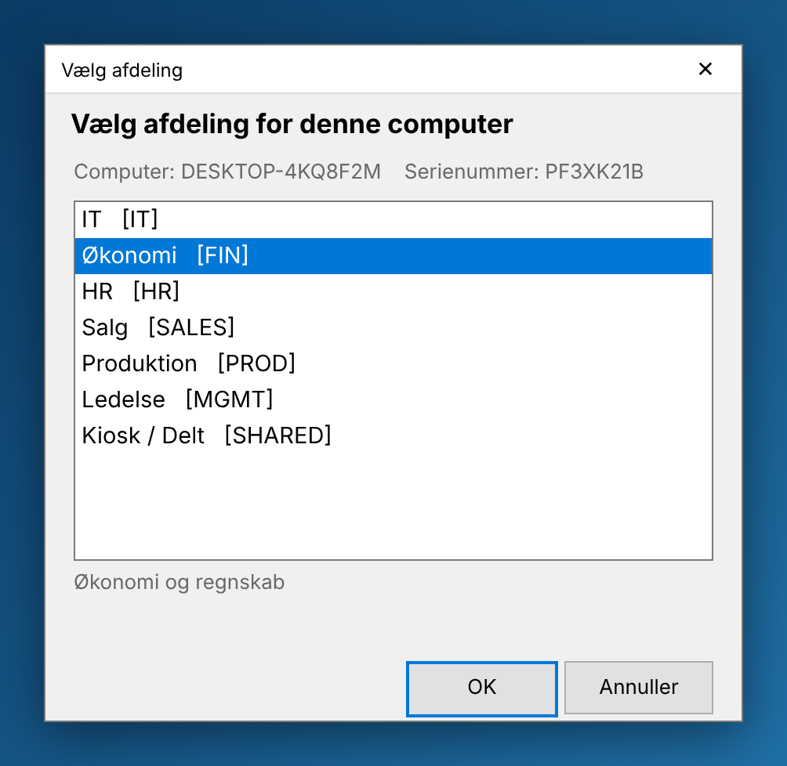
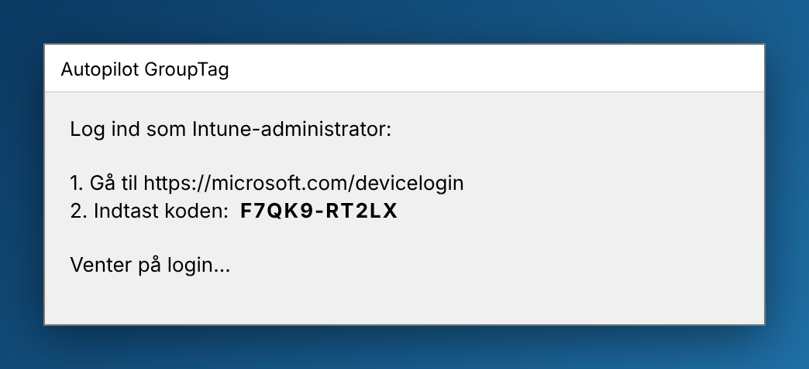
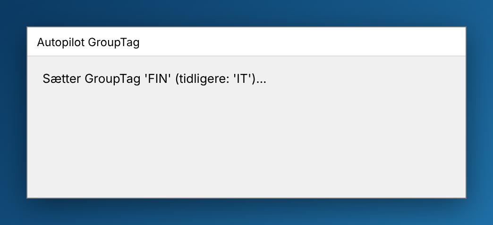
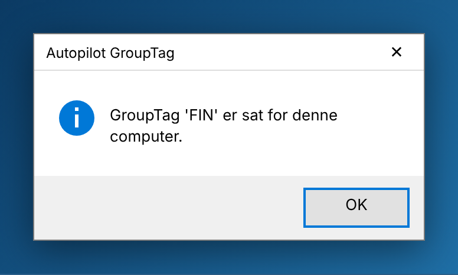
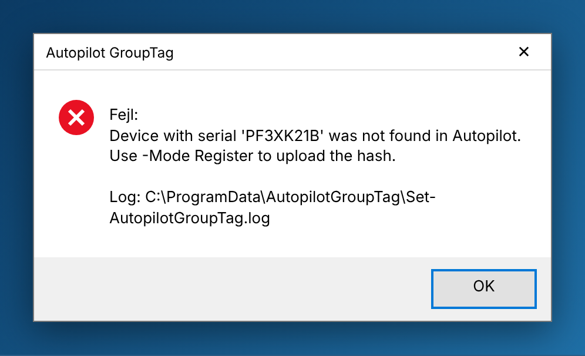

# Autopilot GroupTag-vælger

`Set-AutopilotGroupTag.ps1` viser et vindue, hvor man vælger afdeling. Den valgte afdelings
GroupTag skrives derefter på enhedens Windows Autopilot-objekt via Microsoft Graph. Scriptet kræver
ingen PowerShell-moduler, så det virker også i OOBE.

| Fil | Indhold |
| --- | --- |
| `Set-AutopilotGroupTag.ps1` | Selve scriptet: GUI, login og Graph-kald |
| `GroupTags.json` | Liste over afdelinger og deres GroupTags. Ret den, så den passer til jeres afdelinger |

## Sådan ser det ud – trin for trin

> Billederne er mockups lavet ud fra scriptets layout (samme tekster, størrelser og placeringer).
> Det rigtige vindue bruger Windows' egen stil og kan se en anelse anderledes ud.

**1. Vælg afdeling.** Vinduet viser computernavn og serienummer. Vælg en afdeling (eller dobbeltklik
på den), og tryk **OK**. OK-knappen er grå, indtil der er valgt en afdeling. Under listen vises
beskrivelsen fra `GroupTags.json`. **Annuller** stopper scriptet med returkode `1602`.



**2. Log ind** (kun ved device code-login). En tekniker går til adressen på sin telefon eller PC,
indtaster koden og logger ind med en Intune-administratorkonto. Vinduet venter, indtil login er
gennemført. Koden udløber efter ca. 15 minutter. Med app-only-login (`-ClientSecret`) springes trinnet over.



**3. GroupTag sættes.** Scriptet finder enheden i Autopilot via serienummeret og skriver den nye
GroupTag. I `Register`-tilstand ser du i stedet "Uploader hardware hash..." og "Import status: ...".
Det kan tage 5–15 minutter.



**4. Færdig.** Tryk OK. Værdien gemmes i `HKLM\SOFTWARE\AutopilotGroupTag`, og scriptet afslutter med `0`.



**Ved fejl** viser vinduet fejlbeskeden og stien til loggen, og scriptet afslutter med `1`. Den
hyppigste fejl er, at enheden ikke er registreret i Autopilot. Kør i så fald med `-Mode Register` i OOBE.



## Tilstande

* **`-Mode Update`** (standard): enheden er allerede registreret i Autopilot. Scriptet finder den
  via serienummer og sætter GroupTag.
* **`-Mode Register`**: enheden er ikke registreret endnu (OOBE, Shift+F10). Scriptet uploader
  hardware-hash med GroupTag og venter, til importen er færdig.

## Login

* **Device code (anbefales):** kør uden `-ClientSecret`. Vinduet viser en kode, og en tekniker logger
  ind på sin telefon/PC med en konto, der har rettigheder til Intune/Autopilot. Der ligger ingen
  hemmeligheder på maskinen.
* **App-only:** `-TenantId <tenant> -ClientId <appId> -ClientSecret <secret>`. Kræver en app-registrering
  med applikationsrettigheden `DeviceManagementServiceConfig.ReadWrite.All` (med admin consent).
  Bemærk: hvis en secret pakkes ind i en Intune-app, kan den læses af alle med adminadgang til
  maskinen. Giv den kort levetid.

## Brug

```powershell
# OOBE: Shift+F10, så:
powershell -ExecutionPolicy Bypass -File D:\autopilot\Set-AutopilotGroupTag.ps1 -Mode Register

# Uden GUI
powershell -ExecutionPolicy Bypass -File .\Set-AutopilotGroupTag.ps1 -NoGui -GroupTag FIN
```

### Under ESP (Win32-app i Intune)

Intune kører Win32-apps som SYSTEM i session 0, så et vindue kan ikke ses uden videre. Pak
`ServiceUI.exe` (fra MDT) med i `.intunewin`-pakken og brug følgende som installationskommando:

```
ServiceUI.exe -process:explorer.exe %SYSTEMROOT%\System32\WindowsPowerShell\v1.0\powershell.exe -ExecutionPolicy Bypass -File Set-AutopilotGroupTag.ps1
```

(Under device-ESP findes `explorer.exe` ikke endnu. Prøv i stedet `-process:winlogon.exe`, eller kør
appen i user-ESP-fasen.)

* **Detektionsregel:** registreringsdatabasen `HKLM\SOFTWARE\AutopilotGroupTag`, værdien `GroupTag` findes.
* **Returkoder:** `0` = succes, `1` = fejl, `1602` = annulleret af brugeren.
* **Log:** `C:\ProgramData\AutopilotGroupTag\Set-AutopilotGroupTag.log`

## Vigtigt om timing

Autopilot-profilen er allerede valgt, når ESP kører. Hvis GroupTag ændres under ESP, påvirker det
kun **dynamiske grupper** (f.eks. `(device.devicePhysicalIds -any (_ -eq "[OrderID]:FIN"))`), og
Entra ID kan være op til flere minutter om at opdatere medlemskabet. Afdelingsspecifikke apps og
politikker kommer derfor typisk først efter ESP. Hvis GroupTag skal styre selve Autopilot-profilen,
så brug `-Mode Register` i OOBE, før enheden tilmeldes.
